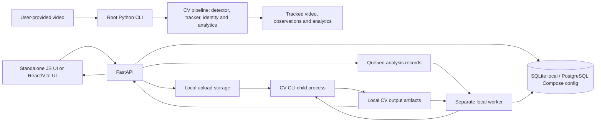

# Project Audit and New-Repository Readiness

**Review scope:** the project tree as present for this audit.  
**Mode:** read-only inspection; no dependencies were installed, no tests or inference were run, no database was changed, and no Git repository was initialized. The user subsequently authorized a focused launcher change, recorded in the post-audit note at the end.

## 1. Executive Summary

This bundle combines two related but distinct applications:

1. A Python/OpenCV/Ultralytics football-video pipeline at the project root. It detects and tracks players, goalkeepers, referees and the ball, maintains identity/team evidence, estimates possession and passes, and writes annotated video and CSV/JSON analytics.
2. An OmniBoard web application under `omniBoard/`, with a FastAPI backend, a database-backed project/video/analysis lifecycle, and a separate worker that launches the root CV pipeline as a child process.

There are also **two frontend clients**: the vanilla JavaScript standalone UI in `OmniBoard-Frontend~/frontend` and a React/TypeScript Vite app in `omniBoard/frontend`. Their authentication and API usage differ. The onboarding document identifies the standalone UI as the intended recipient experience.

**Repository publication is not safe yet.** There is no Git repository at the project root and no root `.gitignore`, but private `.env` files, local databases/uploads/results, Python environments, and large model assets are present. A broad first `git add` could include sensitive configuration and generated data. The overall model files include multiple binaries over GitHub's normal 100 MiB file limit. The model/data licenses and distribution rights also need decisions.

The web worker has an integration/deployment mismatch: the supplied Compose stack uses PostgreSQL and does not run a worker, while the worker's job-claim path uses SQLite-specific SQL. The documented local SQLite setup is a separate deployment mode.

No fixes or repository operations are performed here. Priorities and an approval-gated publishing sequence are in sections 16–17.

## 2. Project Purpose and Current Capabilities

### Intended problem and users

The root pipeline is intended for football/soccer analysts who want player/ball tracking and match-derived visualizations from a video. The OmniBoard web application adds user accounts, projects, video upload, queued processing, and analysis artifact access.

### Capabilities supported by inspected code

- CLI video analysis through `main.py`.
- Ultralytics model inference with supported backend selection, tracker options, frame limits, replay stubs and checkpoint/resume options.
- Player/goalkeeper filtering, referee handling, team-color assignment and canonical identity tracking.
- Ball-gap interpolation, possession estimation, pass evidence and match/player/team analytics.
- Annotated/tracked video, observations, rejection and analytics artifacts.
- FastAPI authentication, users/items/projects, video upload, analysis queue/status/cancellation, and artifact routes.
- A separate worker launches the CV CLI and updates analysis state and artifact records.
- The standalone JavaScript client uses cookie/CSRF authentication and the `/api/projects/...` compatibility surface, plus `/api/v1/analyses` for analysis workflows.
- The React/Vite client uses the standard API and bearer access-token flow.

### Implemented vs. unverified

These are findings from source and tests, not end-to-end verification in this audit. Real-video accuracy, device availability, installed model compatibility, completed web analysis, browser playback, and generated-asset correctness were not tested. The existing automated suites are meaningful unit/API/UI coverage but do not establish model accuracy or full video-result quality.

## 3. Technology Stack

| Area | Technologies evidenced in project files |
|---|---|
| CV pipeline | Python, OpenCV, Ultralytics/YOLO, PyTorch/torchvision, NumPy, SciPy, scikit-learn, PyYAML, Matplotlib; optional OpenVINO; FFmpeg/ffprobe for web-worker media handling |
| Backend | Python 3.14+, FastAPI, Pydantic Settings, SQLModel/SQLAlchemy, Alembic, SQLite for the documented local setup, PostgreSQL support/configuration, JWT/password hashing, cookie/CSRF auth, local filesystem storage |
| React web client | React/TypeScript, Vite, generated API client, Playwright; Bun and npm lock/config files are present |
| Standalone web client | Vanilla JavaScript, HTML and CSS; served from `OmniBoard-Frontend~/frontend` with Python's built-in HTTP server; no Node install/build required for this client |
| Environments | Separate CV Python 3.10 environment at root and backend Python 3.14+ environment managed by `uv` in `omniBoard/.venv` |
| Local orchestration | PowerShell launcher `start-local.ps1`; Compose files exist for a separate PostgreSQL/proxy/deployment path |

## 4. Directory Structure

Meaningful project layout (generated/runtime content abbreviated):

```text
.
├── main.py                         # Root CV CLI and pipeline orchestration
├── utils/                           # CV tracking, identity, analytics and rendering
├── config/                          # BoT-SORT and ByteTrack configuration
├── tests/                           # Root CV unit/regression tests
├── models/                          # PyTorch weights and OpenVINO export
├── data/                            # Present but empty in the audited tree
├── OmniBoard-Frontend~/frontend/    # Intended standalone vanilla-JS web UI
├── omniBoard/
│   ├── backend/
│   │   ├── app/                     # FastAPI, domain, worker and migrations
│   │   ├── tests/                   # Backend/API/worker tests
│   │   ├── local-data/              # Local uploaded media and generated results
│   │   └── sql_app.db               # Local SQLite database
│   ├── frontend/
│   │   ├── src/                     # React/TypeScript/Vite app
│   │   └── tests/                   # Playwright tests
│   ├── packages/react-email/        # Email template package
│   ├── scripts/, hooks/, .github/   # Project scripts and CI/development setup
│   ├── compose*.yml                 # PostgreSQL/proxy/development/deployment configs
│   ├── uv.lock, bun.lock, package-lock.json
│   └── .env                         # Private backend settings (do not publish)
├── .env                             # Private local settings (do not publish)
├── .gitattributes                   # Git LFS attributes for PyTorch weights
├── requirements*.txt                # Root CV dependency manifests
├── onboarding.txt                   # ZIP recipient setup guide
├── PRE_REGRESSION_ACCEPTANCE.md     # Regression procedure/documentation
├── start-local.ps1                  # Windows local web-app launcher
├── README.md                        # Root CV pipeline documentation
└── kernel.errors.txt                # Unclassified kernel diagnostic output
```

A file inventory excluding virtual environments, caches and local/generated data found 435 source/config/documentation/artifact files across the tree. This is an inventory count, not a count of maintained application modules.

## 5. Complete Module Inventory

### 5.1 Root CV application

`main.py` is the executable CLI and orchestrator. It owns argument parsing/validation, model/backend loading, video loop, integration of tracking/analysis/rendering, and artifact finalization. Relevant areas include backend selection (`main.py:146-362`), CLI arguments (`395-543`), input/run setup (`814-926`), tracker loop (`1615+`) and finalization (`2491-2505`). Defaults include model `models/best.pt`, video `data/vid_for_data_15s.mp4` and output root `output/`; `FOOTBALL_MODEL`, `FOOTBALL_VIDEO` and `FOOTBALL_OUTPUT_DIR` can override paths (`main.py:118-120`).

| Module | Purpose and key API | Use/status |
|---|---|---|
| `utils/ball_tracking.py` | `BallPositionTracker.update()`/`finish()` buffers missing detections and interpolates bounded, two-sided ball gaps | Active |
| `utils/camera_motion.py` | `CameraMotion`, `CameraMotionEstimator`, `CameraReference` estimate camera movement/reference state | Used for camera-motion support; validate use for each mode |
| `utils/camera_radar.py` | `CameraRadarRenderer.render()` renders camera-space player/ball positions | Active; current radar is not calibrated pitch space |
| `utils/class_aware_tracker.py` | `ClassAwareByteTrack`, `register_class_aware_bytetrack()` implement class-aware ByteTrack | Present but not selected by `main.py`; active tracker is BoT-SORT |
| `utils/dashboard.py` | `output_size()`, `compose_dashboard()` build output video/dashboard layout | Active |
| `utils/detection_classes.py` | `normalize_class_name()`, `map_class_categories()` normalize model class labels | Active support |
| `utils/final_team_reconciliation.py` | `reconcile_final_team_labels()` applies final team-label/possession reconciliation | Online canonical-ID output path |
| `utils/global_identity_manager.py` | `GlobalIdentityManager` associates tracker IDs with persistent global player identities and checkpoint state | Active |
| `utils/match_analytics.py` | `write_match_analytics()` reads observations and writes player/team/pass analytics | Active at finalization |
| `utils/offline_identity_reconciliation.py` | `reconcile_observations()` builds tracklets and conservatively reconciles identities after processing | Offline canonical-ID mode |
| `utils/pass_detection.py` | `EvidenceBasedPassDetector` records pass evidence, outcomes and team counts | Active |
| `utils/phase1_analysis.py` | Tracking-stub writer/reader and `Phase1Analyzer` diagnostics/contact sheets | Optional `--cache-stub`/`--use-stub` path |
| `utils/pipeline_checkpoint.py` | Save/load/restore resumable state and output-file offsets | Optional checkpoint/resume path |
| `utils/pitch_radar.py` | `SoccerPitchConfiguration`, `PitchRadarProjector` for calibrated pitch projection | Present but pitch calibration is disabled; not the current camera radar |
| `utils/pitch_region.py` | Playing-area/grass/referee-overlap helpers | Active input filtering; fixed image-space heuristics |
| `utils/player_observations.py` | `PlayerObservation`, `BallObservation`, CSV conversion | Active data records |
| `utils/possession_utils.py` | `PossessionEstimator.update()`/`percentages()` estimates possession from image-space distance/history | Active; estimate, not pitch-space ground truth |
| `utils/referee_tracking.py` | `RefereeTrackManager` tracks referee classification/history and visible IDs | Active support for filtering/rendering |
| `utils/run_directories.py` | `create_next_run_directory()` creates sequential `run_N` output locations | Active |
| `utils/team_color_utils.py` | `TeamColorAssigner`, `CanonicalTeamSmoother`, conflict tracker assign/smooth team labels | Active |
| `utils/tracking_input_filter.py` | `PlayerTrackingInputFilter`, `attach_tracker_ids()` filters detections and maps tracker IDs | Active before tracker updates |
| `utils/visualization_utils.py` | `is_displayable_player()`, `draw_annotations()` decide/draw displayable detections | Active |

`config/custom_botsort.yaml` is the active tracker configuration (`main.py:121`); `config/custom_bytetrack.yaml` is not selected by the current entry point.

### 5.2 Web backend

The backend source is under `omniBoard/backend/app/`.

| Module/group | Responsibilities and public surface |
|---|---|
| `main.py`, `api/main.py` | Create FastAPI app, include routers under `/api/v1` and `/api`, serve the generated frontend from `app/frontend` |
| `api/deps.py` | DB session dependency; resolves bearer token or cookie identity, active/superuser checks and CSRF enforcement |
| `api/routes/login.py` | Bearer login/test, password recovery/reset and email operations |
| `api/routes/users.py` | Signup, current-user/profile/password operations, user listing/admin CRUD |
| `api/routes/items.py` | Authenticated item CRUD |
| `api/routes/projects.py` | Standard project create/list/read |
| `api/routes/analyses.py` | Queue/dispatch, analysis read/list, cancellation, artifacts, deletion/history cleanup |
| `api/routes/client_auth.py` | Separate `/api/auth` cookie-session endpoints, including CSRF, register/login/me/logout |
| `api/routes/client_projects.py` | `/api/projects/{board\|media}` client snapshot CRUD and ownership/project-kind validation |
| `api/routes/client_media.py` | Owned client-project video upload/list compatibility API |
| `api/routes/private.py` | Development-only private user creation |
| `api/routes/utils.py` | Health-check and test-email route |
| `models.py` | SQLModel user/item/project/video/analysis/artifact models, enums, validation and response schemas |
| `crud.py` | User lookup/create/update/authentication and item persistence helpers |
| `core/config.py` | Environment settings for secrets, DB/data paths, upload limits, mail, frontend/CORS, worker/CV executable/model; validates selected values |
| `core/database.py`, `core/db.py` | SQLAlchemy engine/SQLite setup and shared session/database initialization |
| `core/security.py`, `core/cookie_auth.py` | Password/JWT operations and signed double-submit CSRF helpers |
| `services/video_storage.py` | Filename/extension/signature/container checks, chunked file write, SHA-256 and temporary-to-final upload promotion |
| `worker/manager.py` | Single local worker process lock, job claim/state lifecycle, cancellation/shutdown and interrupted-job recovery |
| `worker/cv_adapter.py` | Validates CV settings, starts CV CLI subprocess, consumes progress, validates outputs and persists artifact metadata/checksums |
| `worker/__main__.py` | Worker module entry point |
| `utils.py`, `initial_data.py` | Email/template/token helpers and initial DB/superuser creation |
| `alembic/` | Separate SQLite and PostgreSQL migration histories/configuration |

### 5.3 Web clients and support packages

- `OmniBoard-Frontend~/frontend/` is the onboarding-designated standalone client: `index.html`, `projects.html`, `media.html`, and `cv-analysis.html`; 21 JavaScript files cover auth, state, theme/i18n, project/media UI and CV upload/polling; CSS is under `css/`. `js/core/auth.js` uses cookie credentials and CSRF, and defaults localhost API calls to port 8000. `js/media/analysis-workflow.js` uploads, queues, polls and cancels analyses. `js/bootstrap.js` invokes page-specific initializers. It is served as static files; no frontend build is required.
- `omniBoard/frontend/src/` is a distinct React/TypeScript/Vite application. Routes cover login/signup/password recovery, home/layout, projects, analysis results, items, admin and settings. Components are grouped into Admin, Items, UserSettings, Common, Sidebar and UI primitives; hooks and `client/` supply auth/UI helpers and generated API client code. Vite outputs to `backend/app/frontend`.
- `omniBoard/packages/react-email/` contains email templates and package support.
- `omniBoard/scripts/`, `backend/scripts/`, `.github/workflows/`, `.vscode/`, `hooks/`, `.agents/`, and `.claude/` contain development, testing, CI, editor and agent customization material. They are not runtime application modules.

The two browser clients are not interchangeable by assumption: the React client uses bearer auth and standard `/api/v1` endpoints; the standalone client uses cookie/CSRF and compatibility project/media endpoints while also calling standard analysis routes.

### 5.4 Tests and test helpers

- Root CV tests: `tests/test_ball_interpolation_pipeline.py`, `test_ball_tracking.py`, `test_canonical_id_modes.py`, `test_final_team_reconciliation.py`, `test_global_identity_manager.py`, `test_inference_backend.py`, `test_match_analytics.py`, `test_offline_identity_reconciliation.py`, `test_pass_detection.py`, `test_phase1_analysis.py`, `test_pipeline_checkpoint.py`, `test_player_observations.py`, `test_possession_utils.py`, `test_run_directories.py`, `test_team_color_utils.py`, `test_tracking_input_filter.py`, and `test_tracking_visualization.py`.
- Backend tests: `omniBoard/backend/tests/test_cv_adapter.py`, `test_domain_models.py`, `test_sqlite_foundation.py`, `test_video_storage.py`, `test_worker_manager.py`; API route tests for analyses, client analysis dispatch, client auth/media/projects, items, login, private and users; `crud/test_user.py`; fixtures and helper builders under `tests/conftest.py` and `tests/utils/`.
- React/Playwright specs cover admin, analysis upload/queue workflow, items, login, password reset, signup and user settings, with auth/config/API/mail/test helpers under `omniBoard/frontend/tests/`.
- The Playwright analysis workflow tests queue/status behavior, not real inference or successful completed-result playback. Backend worker tests use fake CV subprocesses; real inference is outside normal backend pytest.

## 6. Application Execution Flow

### Root CLI

1. `python main.py` parses CLI/environment settings, resolves input/model/output paths and validates modes.
2. It loads the configured Ultralytics/PyTorch or optional OpenVINO inference backend and tracker.
3. Video frames are read; detections are filtered before tracking; tracker IDs are attached; referee/visibility/confidence eligibility, teams and canonical IDs are updated.
4. Ball/player observations feed interpolation, possession and pass evidence; visualizations/dashboard and observations are produced.
5. Finalization writes tracked video and observation/rejection/analytics artifacts under `output/run_N/`.

The default sample video path is not bundled; callers must supply a real permitted video. `--max-frames` provides a bounded smoke-run mode.

### Web application

1. The Windows one-command launcher starts the API, analysis worker and standalone UI; the API and worker use the same configured DB and local data paths.
2. User creates/selects a project and uploads a supported video. Backend validates basic extension/signature/container properties, streams it to local storage, computes SHA-256, and creates video/queued analysis DB records.
3. Worker claims a queued job, launches the configured CV interpreter and `main.py` as a child process, reads progress, and records final status/artifact metadata.
4. Browser polls status and can request cancellation. On success, the results view can play a browser video and download observations CSV; other analytics artifacts are not all exposed as direct UI download controls.

The API alone does not execute CV inference. Without a worker, uploaded work remains queued.

## 7. Architecture and Data Flow



The web integration uses an API/database plus a local filesystem and child process; it is not a single in-process server or a distributed storage/queue architecture. Worker, API and CV process need compatible configuration and access to the same DB/data locations.

## 8. Dependencies and Environment Requirements

- `requirements.txt` lists unpinned root CV packages including Ultralytics, NumPy, SciPy, OpenCV, Matplotlib, pytesseract, scikit-learn, PyYAML, PyTorch/torchvision and pytest. PyTorch build selection is hardware-specific; the README asks users to choose a compatible build separately.
- `requirements-openvino.txt` layers optional OpenVINO on top of root requirements.
- CV setup uses Python 3.10 in root `.venv-1`; web backend uses Python 3.14+ in `omniBoard/.venv`. Do not interchange these interpreters.
- `omniBoard/uv.lock` and `omniBoard/backend/pyproject.toml` pin/define the backend environment. `omniBoard/bun.lock` and `omniBoard/package-lock.json` support web/frontend dependencies. These make the web stack more reproducible than the root CV requirements.
- FFmpeg/ffprobe are required for the automatically started upload worker and browser-video output, but not for running a basic root CLI analysis. CUDA requires a compatible GPU and matching PyTorch build. OpenVINO is optional.
- Local web app defaults are SQLite and `local-data`; Compose files separately configure PostgreSQL, proxy and ancillary services.

## 9. Testing and Reliability Assessment

### Existing validation coverage

The root suite tests identity, filtering, backend choices, tracking observations, interpolation, possession, pass/analytics, reconciliation, checkpoint and output-directory behavior. The backend suite exercises API ownership/lifecycle, uploads, storage, migrations/domain setup, worker manager and CV-adapter subprocess handling. Playwright tests cover the React app's account/settings/admin/item paths and a queued analysis workflow.

The project documents:

- Root CV: selected `python -m unittest ...` modules in `README.md:252-254`; test dependencies are in `requirements.txt`.
- Backend: `uv run pytest`, plus backend test scripts/docs.
- React frontend: `bun run build`, `bun run test`; `lint` is configured with Biome `--write --unsafe`, so it is not read-only.
- A root `PRE_REGRESSION_ACCEPTANCE.md` describes safe validation/full-video evaluation, but references `scripts/run_pre_regression_checks.py`, which is absent in the audited tree. It also hard-codes a prior machine path.

### This audit's checks

- Read-only file/config/Git inventory and redacted presence checks for private settings.
- Verified absence of project-root `.git`, root `.gitignore`, root `LICENSE`, root `scripts/run_pre_regression_checks.py`, and that root `data/` has no files.
- Confirmed Git LFS is installed and examined LFS attributes.
- **No unit tests, builds, lint, database migration, API startup, model load or inference were run.** Therefore this report does not claim a passing test baseline.

### Reliability limitations evidenced

- Root README states at `README.md:128-135` that the MVP does not infer passes or export observation records, but code calls pass detection and observation/analytics output (`main.py:1485, 1518, 2491-2505`) and tests exist. Correct the documentation after validating the intended behavior.
- CV ROI/grass/referee filters are image-space heuristics, not calibrated or shot-aware. Misclassified staff may pass them. Ball/possession and radar are camera-space approximations, not verified pitch-space metrics.
- Root README reports slow throughput on a validation clip; performance and long-match storage need measurement/optimization. The report does not independently reproduce those claims.
- Web upload checks do not constitute complete codec/corruption validation. A failure between file promotion and DB commit can leave an orphan upload (documented in backend README).
- Results UI does not expose all stored analytics artifact kinds as direct downloads.
- Backend supports two auth/API styles; inspect intended compatibility-client support before removing duplicate routes.
- Compose worker/PostgreSQL compatibility requires resolution before presenting Compose as a complete processing deployment.

## 10. Git and Repository Readiness

- The project root is **not a Git repository**. No `.git` exists at root or in the inspected child application directories.
- Consequently there is no current branch, index, tracked/untracked/modified status, remote, or commit history to inspect. A Git-history secret scan is impossible until there is a repository/history.
- Root `.gitignore` is absent. `omniBoard/.gitignore`, `omniBoard/backend/.gitignore`, `omniBoard/frontend/.gitignore`, and `OmniBoard-Frontend~/frontend/.gitignore` exist, but their scope/patterns do not provide root-level protection for the root `.env`, `.venv-1`, root data/output, and root model files.
- `.gitattributes` contains Git LFS filters for `models/best.pt` and `*.pt`. Git LFS is installed locally. The 370.66 MiB OpenVINO `best.bin` does not match those `.pt` patterns.
- Dependency manifests are present; there is no root CV lockfile.
- `omniBoard/LICENSE` is an MIT license bearing the upstream FastAPI author's copyright. There is no root license covering this combined project. Do not assume the nested template license grants rights to the CV code, all dependencies, models or videos.

## 11. Security and Sensitive-File Risks

**Do not publish the current tree with a blanket `git add -A`.**

- Root `.env` and `omniBoard/.env` are both present and contain private settings/credential fields. Their values are intentionally omitted here. The backend `.gitignore` protects its nested environment file if the root is a Git repo, but there is no root `.gitignore` to protect the root `.env`.
- `omniBoard/backend/sql_app.db` and `omniBoard/backend/local-data/` include a local DB, uploaded media, worker state, logs and generated result files. Treat uploads/results as potentially private data; no ownership/distribution review was performed.
- Virtual environments, Python caches, generated frontend assets, test reports, and video/model outputs are present or expected in-tree and must be excluded from a clean repository.
- The nested client auth flow includes CSRF/cookie checks and backend artifact ownership/path-containment checks, but this was a code-architecture audit, not a penetration/security review.
- No credentials or environment values are reproduced in this report. If a secret is ever pushed or shared externally, rotate it rather than merely deleting the current file.

## 12. Large Files and Asset Management

Measured files exceeding 50 MiB:

| Asset | Approx. size | Notes |
|---|---:|---|
| `models/best.pt` | 185.93 MiB | Main root CV weights; `.gitattributes` has LFS filter |
| `models/key_point_best.pt` | 133.56 MiB | Model weights; `.pt` LFS rule applies |
| `models/omniboard_player_best.pt` | 130.45 MiB | Model weights; `.pt` LFS rule applies |
| `models/best_openvino_model/best.bin` | 370.66 MiB | OpenVINO exported weights; not covered by current `.pt` LFS rules |

`yolo26n-cls.pt` is about 5.5 MiB. The local worker data also contains uploaded and generated videos, segment files, CSVs and analysis outputs; those should not be versioned as source assets.

Before choosing Git LFS or external hosting, record model provenance, ownership/license, download source, checksums, and whether recipients may redistribute the files. If binaries are published with LFS, add rules for the selected `.bin` files, document Git LFS installation/quota expectations, and verify the LFS objects are actually pushed. Git LFS is installed locally, but no repository or LFS objects were examined.

## 13. Known Issues, Dead Code, and Technical Debt

| Priority | Finding | Evidence / follow-up |
|---|---|---|
| Critical | Root publishing ignore rules are missing while private config and local data are present | Root `.gitignore` absent; private `.env`, backend DB and `local-data/` exist. Add and test root ignore rules before initializing/publishing |
| High | Model assets exceed GitHub regular-file limit and `.bin` is not covered by LFS | `models/*.pt` LFS filter exists; OpenVINO `.bin` is 370.66 MiB. Decide distribution and extend LFS or externalize |
| High | Worker deployment story conflicts with PostgreSQL Compose configuration | `worker/manager.py:224-228` uses SQLite-specific `BEGIN IMMEDIATE`; `compose.yml` has PostgreSQL and no worker service |
| High | Runtime depends on two different Python versions and hardware-dependent CV packages | Root CV 3.10 vs backend >=3.14; root `requirements.txt` is unpinned |
| Medium | Root README has stale claims about pass detection/record export | `README.md:128-135` conflicts with `main.py` and existing tests |
| Medium | Regression gate documentation references a nonexistent script and absolute old machine paths | `PRE_REGRESSION_ACCEPTANCE.md` references absent `scripts/run_pre_regression_checks.py` and `C:\omniBoard-Sportz\...` |
| Medium | Two frontends and two auth/API patterns increase maintenance surface | Standalone client uses cookie/CSRF compatibility API; React app uses bearer `/api/v1` API |
| Medium | Stored analytics artifacts are not all surfaced by the results UI | Compare backend artifact kinds with analysis route UI actions |
| Medium | Root/model/video and generated/local artifacts require explicit licensing/privacy and retention decisions | Assets and local data exist; rights and data handling not established by this audit |
| Low | `class_aware_tracker.py`, `custom_bytetrack.yaml`, and `pitch_radar.py` appear unused by the current default CV flow | Verify intended alternate use before removing; do not delete as cleanup without evidence |
| Low | `kernel.errors.txt` appears to be a stray diagnostic artifact, not application documentation | Establish provenance before excluding or removing |
| Low | `OmniBoard-Frontend~` uses a tilde in its directory name | Works in quoted paths but is unusual for tooling/documentation; consider a controlled rename only if all paths/tests are updated |

## 14. Recommended Repository Structure

**Low-risk initial publication should preserve the present directory layout.** Renaming or moving either app before publication would add path and deployment risk. A reviewed first version can keep:

```text
.
├── README.md
├── LICENSE                    # Must be selected for the combined project
├── .gitignore
├── .gitattributes
├── onboarding.txt              # May later be renamed to onboarding.md
├── main.py / utils/ / config/ / tests/
├── models/README.md            # Provenance, download/LFS/checksum policy
├── requirements*.txt
├── start-local.ps1
├── OmniBoard-Frontend~/frontend/
└── omniBoard/
    ├── backend/
    ├── frontend/
    ├── packages/
    ├── scripts/
    ├── compose*.yml
    ├── uv.lock
    └── bun.lock / package-lock.json
```

After tests/docs are stable, a later approved reorganization could group the root code under `cv/`, the web client/backend under `web/`, and static bundle under a clearer name. That is optional and should not be mixed into initial Git setup.

### Proposed root `.gitignore` policy

Use explicit rules for:

```gitignore
# Local credentials (keep only safe templates)
.env
.env.*
!.env.example
**/.env
**/.env.*
!**/.env.example

# Python environments and caches
.venv/
.venv-*/
**/.venv/
**/__pycache__/
*.py[cod]
.pytest_cache/
.mypy_cache/
.ruff_cache/
.coverage*
htmlcov/

# Frontend installs/build/test outputs
node_modules/
**/node_modules/
**/dist/
**/build/
**/test-results/
**/playwright-report/

# Local databases, uploads, outputs, logs and temporary artifacts
*.db
*.db-*
*.sqlite*
**/local-data/
output/
uploads/
*.log
*.tmp

# User media and model weights: include only after an explicit rights/hosting decision
*.mp4
*.mov
*.avi
*.mkv
*.pt
*.bin
```

The weight exclusions must be reconciled with the approved model policy: if selected weights should ship in Git LFS, either avoid ignoring the exact approved paths or force-add only those reviewed paths, and document their LFS treatment. Do not accidentally exclude safe source model metadata or examples.

## 15. Proposed README and Documentation Plan

The root README should become a landing page for the combined application and link to focused docs:

1. Purpose, target users, verified features vs. experimental/unverified claims.
2. Architecture diagram and distinction between CV CLI, FastAPI, standalone UI, React/Vite app and worker.
3. Windows setup first (current onboarding focus), then tested macOS/Linux variants.
4. Exact environment requirements and reproducible setup for CV and backend.
5. `.env.example` creation/secrets guidance without committing real `.env`.
6. Model provenance/license/download or Git LFS instructions and video/data setup.
7. CLI examples and bounded smoke test; web app and optional upload-worker startup.
8. Tests/build/lint commands and what they do; state clearly if a test requires model/video/GPU.
9. Database/storage backup, migration, deployment/worker constraints.
10. Limitations, known issues, licensing, third-party/model/data attribution and support.

Also repair the stale pass/export claims and the regression-gate command/path before publication. Keep platform-specific paths as portable placeholders or `$PSScriptRoot`-relative instructions.

## 16. Prioritized Remediation Checklist

1. **Critical — publication safety:** create a root `.gitignore`; review both `.env` files and ensure neither is added; exclude DB, `local-data`, uploads, generated outputs, virtual environments and caches.
2. **Critical — licensing/privacy decisions:** establish ownership/permission for CV code, nested web template code, model weights, fonts/assets, and any sample/uploaded videos; select a root license only after review.
3. **High — model distribution:** decide which weights ship, document provenance/checksums/usage rights, add an explicit `.bin` strategy, and test Git LFS handling and quota requirements.
4. **High — processing deployment:** choose whether worker is local-SQLite-only or make job claiming/storage compatible with the PostgreSQL Compose deployment; document and test that supported topology.
5. **High — reproducibility:** retain separate Python environments, document hardware-specific PyTorch setup, and consider a tested lock/constraints strategy for root CV dependencies.
6. **Medium — docs consistency:** fix README pass/observations claims; make `PRE_REGRESSION_ACCEPTANCE.md` paths portable and either restore or remove the referenced missing gate script.
7. **Medium — product scope:** decide whether both web clients and compatibility auth/project/media APIs are supported; document distinct login/setup paths and complete-results UI expectations.
8. **Medium — testing:** run targeted CV/backend/frontend tests in their intended environments after approving setup; add an end-to-end test with a small licensed fixture and real worker only if resource/runtime constraints allow.
9. **Low — cleanup review:** establish provenance of `kernel.errors.txt`; assess unused alternate tracker/pitch modules but preserve until usage is verified.
10. **Low — maintainability:** consider later splitting `main.py` and renaming the standalone frontend directory as a separate approved change.

## 17. Safe New-GitHub-Repository Publishing Procedure

Do not execute this sequence until the decisions in section 18 are resolved. Commands below are examples to run later from the project root; they were **not** run during this audit.

1. Add and inspect root ignore rules and decide LFS/external storage for each large asset.
2. Check for secrets/media/database/virtualenv exclusions, then initialize only after review:

   ```powershell
   git init -b main
   git lfs install
   git status --short --ignored
   git check-ignore -v .env omniBoard\.env omniBoard\backend\sql_app.db omniBoard\backend\local-data .venv-1
   ```

3. If and only if approved model files will be in Git LFS, add reviewed rules, for example:

   ```powershell
   git lfs track "*.pt"
   git lfs track "models/best_openvino_model/*.bin"
   git add .gitattributes
   ```

   The first rule already exists in the supplied root `.gitattributes`; review the resulting file rather than blindly duplicating it.

4. Stage only after reviewing the file list. Inspect both normal and LFS staging before committing:

   ```powershell
   git add .
   git status --short
   git lfs ls-files
   git diff --cached --stat
   git diff --cached --check
   ```

   If any private/data file appears, stop, unstage it, fix ignore rules, and re-review. Do not rewrite history or assume a delete from the working tree removes a previously committed secret.

5. Create the new GitHub repository through the user's account, choosing visibility and licensing deliberately. Add its actual URL only after creation:

   ```powershell
   git remote add origin <new-repository-url>
   git remote -v
   git push -u origin main
   ```

   No URL, visibility, credential, commit, repository creation, or push is supplied/assumed by this report.

## 18. Questions or Decisions Requiring Approval

1. Which repository visibility is intended: private or public?
2. Who owns the root CV source and model weights, and what license or redistribution terms apply? Are the `.pt` and OpenVINO assets to be hosted in Git LFS, downloaded separately, or excluded?
3. Does `omniBoard/LICENSE` describe only imported template material, and what license should govern the combined repository?
4. Are any local uploaded/generated videos or database records permitted to be retained as public fixtures? The safe default is to exclude all of them.
5. Is the vanilla standalone client the only supported web UI, or should the React/Vite client and compatibility cookie-auth endpoints also be maintained?
6. Should the supported upload-processing topology be SQLite/local worker only, or must the PostgreSQL Compose deployment process analyses too?
7. Should the missing pre-regression check script be restored, or should its documentation be rewritten to a command that exists?

**Audit exit point:** no repository-preparation changes, Git initialization, remote configuration, commit, or push has been performed.

## Post-audit launcher update

After this audit, the user asked that uploads never be left queued because startup omitted the worker. `start-local.ps1` now validates the CV Python 3.10 interpreter, configured model and entry point, FFmpeg and ffprobe for every normal launch; starts the worker automatically; and waits for a readiness file written by the worker after it acquires its lock and recovers interrupted jobs. The worker runs attached to its service window so startup output and errors are visible. After it has started, the worker window retries the worker process every five seconds if it exits. `-WithWorker` remains accepted as a compatibility argument but is no longer needed. `onboarding.txt` now describes this default and retains manual worker startup as a recovery option.

After the user reported a readiness timeout with a blank worker window, startup was changed to avoid piping native worker output through PowerShell and instead use an explicit readiness file from the worker. The worker readiness regression test passed, as did PowerShell syntax validation. The application was not restarted by this audit follow-up and no migrations or CV inference were run. The restart loop only works while the worker PowerShell window remains open; Ctrl+C or closing that window stops it.
